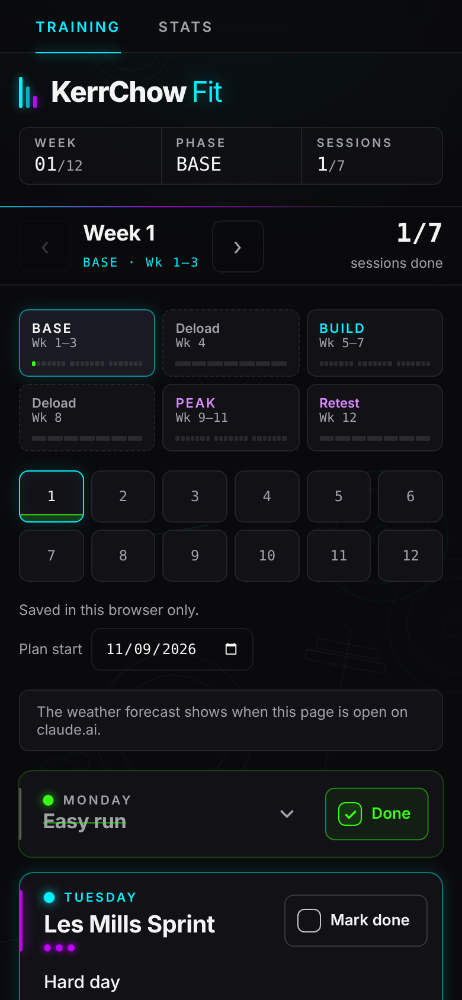
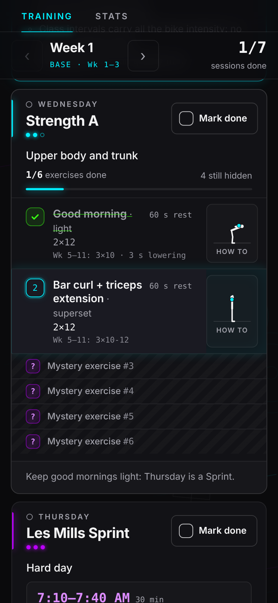
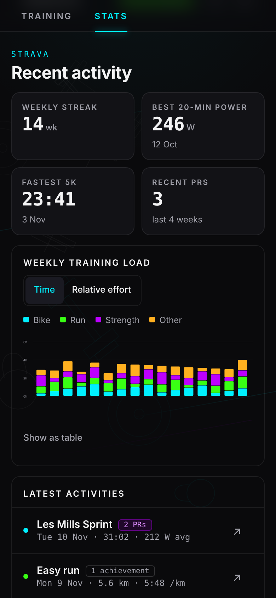

# KerrChow Fit

A 12-week bike, run and strength training tracker: one page with a check-off for every session, strength sessions played as a game, daily weather and a Strava training-load view.

The live version runs as a Claude artifact: https://claude.ai/artifact/DYEHZS3gxQssUfvTXQfN3T

## Screenshots

| Training | Strength session | Stats |
|---|---|---|
|  |  |  |

The Stats screenshot uses sample numbers.

## What's in it

- **Two tabs:** Training (the week, day cards and weather) and Stats (Strava and Garmin).
- **Week tracker:** pick any of the 12 weeks; each day card has a "Mark done" button. Done days collapse to their header.
- **Phase strip:** Base (wk 1–3), Deload (4), Build (5–7), Deload (8), Peak (9–11), Retest (12). Each week shows a 7-segment track: green = done, red = missed (the date has passed and the session wasn't ticked).
- **Weekly plan:**
  - Mon: easy run, 30–35 min
  - Tue / Thu: Les Mills Sprint, 7:10 am, Auckland City. The class, instructor and earlier option come from the club timetable for that date when it has been saved (`classes/lesmills`), else the usual class.
  - Wed: Strength A (upper body + trunk)
  - Fri: easy run + strides (tempo from wk 5; 5×1000 m in wk 9–11)
  - Sat: Strength B (lower body + glutes)
  - Sun: long easy ride, 60–90 min, HR 141–158 bpm
- **Strength sessions as a game:** the six exercises come in a shuffled order each week (seeded by week and plan start date, so every device agrees). Only the current exercise is shown; the rest are collapsed "mystery" strips that open one at a time as you tick each off.
- **Exercise demos:** each exercise has an animated stick-figure demo, form cues and a link to video demos.
- **Weather:** rain and wind for each day (Open-Meteo daytime forecast for Auckland Central; free, open data), with a note on what it means for that day's session.
- **Garmin (Stats tab):** sleep score and stages, overnight HRV, resting heart rate, Body Battery, steps, stress and weekly intensity minutes, from Garmin's official Connect Personal API. Enter your Personal API key under **Garmin API setup** (self-hosted).
- **Strava (Stats tab):** weekly streak, recent PRs, best 20-min power, fastest 5K, a 16-week training-load chart and the latest activities. Self-hosted, enter your Strava API app under **Strava API setup** and connect; on claude.ai the Strava connector is used. Nothing is fetched until the Stats tab is first opened.

## How it works

`index.html` is a single self-contained page (HTML, CSS and JavaScript, no build step). Fonts load from Google Fonts.

Some features use the Claude artifact runtime (`window.claude`), so they only work when the page is open on claude.ai:

| Feature | On claude.ai | Opened directly from this repo |
|---|---|---|
| Check-offs and plan start date | Saved with the artifact and synced across devices (`progress/w1`…`w12`, `settings/plan`) | Saved in the browser's localStorage |
| Strava (Stats tab) | Uses the viewer's Strava connector | Shows a note instead |
| Weather | Reads the forecast saved with the artifact (`weather/auckland`) | Shows a note instead |
| Garmin (Stats tab) | Shows the last saved snapshot (`garmin/latest`) | Shows a note instead |

The weather (`weather/auckland`), class details (`classes/lesmills`) and Garmin snapshot are refreshed once a day by `docker/app/daily.py`, which the self-hosted server runs itself at 5:40 am NZ time; no Claude task is involved. See `DOCKER.md` → *Daily refresh*.

Live Garmin data and the Strava/Garmin setup forms need the self-hosted server (`DOCKER.md`), which keeps the credentials and calls the APIs. The Garmin snapshot (`garmin/latest`) is readable only by the artifact's owner and editors; everything else is readable by anyone the page is shared with.

## Files

- `index.html`: the KerrChow Fit tracker. This is the single source for the page.
- `tools/make-artifact.py`: builds the version that gets published as the Claude artifact (it strips the outer HTML wrapper, which the publisher adds itself).
- `docker/`, `docker-compose.yml`, `DOCKER.md`: the self-hosted version. A small server stores the data and calls the Strava API, the Garmin Connect Personal API and the weather service itself, so the same `index.html` runs without claude.ai. See `DOCKER.md`.
- `tests/`: server tests (pytest) and page checks (node). `.github/workflows/tests.yml` runs them on every pull request.
- `print/`: the original printable A4 training sheet (open `print/index.html` and use Print / save as PDF).

To try it locally:

```bash
python3 -m http.server 8000
```

Then open http://localhost:8000.
